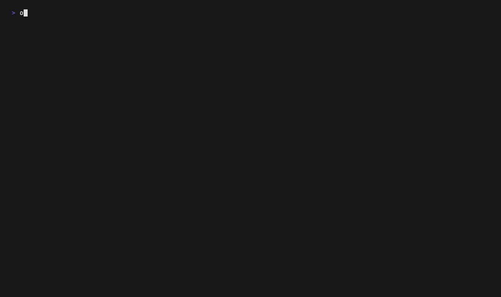
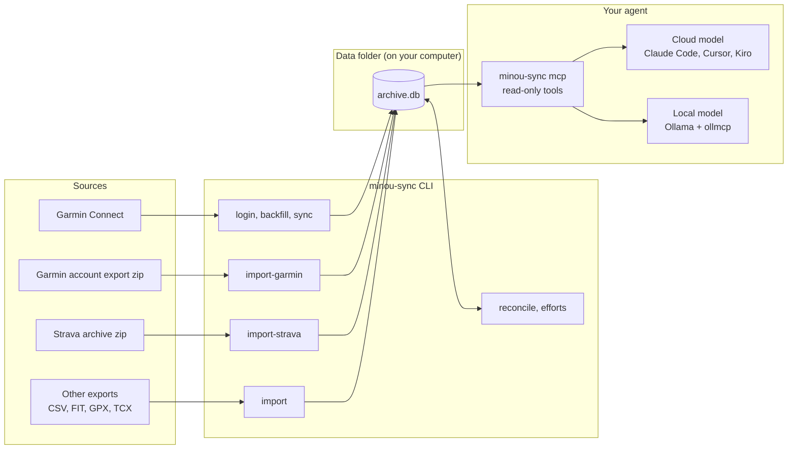
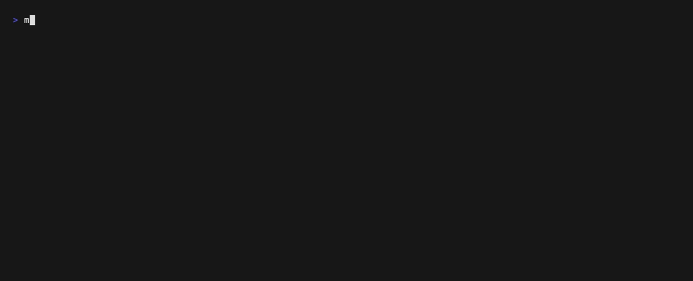

# minou-sync

Your training and health history in one SQLite file on your own computer, ready for an AI agent to read.

minou-sync copies your Garmin Connect data and your Strava history into a single local database. A workout recorded on both appears once. An agent can then answer questions about your training, recovery and upcoming events from your own numbers, with no Garmin or Strava login in the conversation. The agent can be a cloud model or a small model running on your own computer.



New here? [docs/getting-started.md](docs/getting-started.md) takes you from install to asking an agent about your own training.

## How it works



The CLI builds the archive in two passes. It imports from each source and consolidates them, so a workout recorded on two platforms appears once. Then it cleans the result: it flags impossible values and works out your best efforts. `minou-sync mcp` gives an agent read-only tools over the archive, so the agent asks for totals, lists and records and doesn't have to write SQL. Only `login`, `backfill` and `sync` use the network, and only to talk to Garmin.

- **Garmin:** `minou-sync` signs in once with your email, password and MFA code, then uses the saved session tokens. Your password isn't stored. Calls go through the unofficial [`garminconnect`](https://github.com/cyberjunky/python-garminconnect) library, read only, at most one request a second and 500 per run.
- **Garmin's own export:** you can also start from the account export Garmin emails you, with no sign-in. `import-garmin` loads its activities, original files, daily wellness and weigh-ins. Anything sync has already stored is left as it is, and empty fields are filled in.
- **Strava:** you request your account archive from Strava and import the zip. No Strava API key is needed.
- **Other platforms:** any CSV, folder or zip of FIT, GPX or TCX files can be imported through a profile ([docs/import.md](docs/import.md)).
- **Merging:** a Garmin and a Strava activity count as the same workout when they start within 5 seconds of each other, or within 2 minutes with elapsed times within 5% (or 60 seconds for short sessions). Garmin's values are used first, and Strava fills gaps and supplies titles.

## What you get

- **Every activity.** All your Garmin activities and your full Strava history, merged into one table, with the original FIT, GPX or TCX file for each.
- **Every day of Garmin wellness data.** Sleep, HRV, resting heart rate, stress, Body Battery, steps, training readiness, training status, VO2 max and weigh-ins, from your first Garmin activity. `backfill --from YYYY-MM-DD` reaches days before that.
- **Best efforts and records** worked out from your original files: fastest 1 km to 50K for runs, best power and fastest 40 km for rides. Activities with impossible values are flagged and never set a record.
- **The complete Garmin responses.** Every response from Garmin is stored as it came, so you can query fields the summary tables don't have.
- **One command to stay current.** `minou-sync sync` adds new activities and recent days, and `minou-sync schedule` runs it once a day on a Mac and tells you what came in.
- **Plain files too.** CSV copies of the activities and daily wellness tables.

## Questions you can ask an agent

- "How much have I run year to date, distance and elevation?"
- "Sessions by training effect in the last 8 weeks against the 8 before."
- "HRV, sleep and Body Battery in the two days after my five hardest sessions this year."
- "I have a 50 km trail race in six weeks. Based on the last three months, where are the gaps?"

[docs/getting-started.md](docs/getting-started.md#ask-your-questions) has more examples and a system prompt to start with.

## Quick start

You need macOS and a Garmin Connect account (MFA is supported). Linux should work but hasn't been tested. Your Strava account archive is optional, for activities from before you used Garmin.

Install with [pipx](https://pipx.pypa.io), which puts minou-sync in its own environment and the `minou-sync` command on your PATH. It needs Python 3.12 or later.

```sh
brew install pipx
pipx ensurepath        # once; then open a new terminal
pipx install git+https://github.com/andrewtpham/minou-sync.git
```

If you use [uv](https://docs.astral.sh/uv/), `uv tool install git+https://github.com/andrewtpham/minou-sync.git` does the same and fetches Python for you if needed. `pipx upgrade minou-sync` updates it, and `pipx uninstall minou-sync` removes the program but leaves your data.

Then build your archive:

```sh
minou-sync login       # sign in to Garmin, once
minou-sync backfill    # pull your history; rerun until "Backfill complete."
minou-sync sync        # later, whenever you want the latest days
minou-sync schedule    # or run sync every day at 09:00, with a notification when there's something new
minou-sync status      # counts, date range, data folder and archive size
```

The first command asks where to keep your data. Press Enter for `~/.local/share/minou-sync`, or give another folder. `minou-sync setup` changes it later and moves the archive. Any folder on your computer or a connected drive works. For the daily sync, avoid Desktop, Documents, Downloads, iCloud Drive and external drives: macOS asks permission before a program reads those, and a scheduled job can't answer. minou-sync warns if you pick one.

Data from other platforms comes in with `import`. Here the CLI imports a made-up activities CSV and a wellness CSV, merges them and reports what the archive holds:



Then connect an MCP client and ask your questions. For Claude Code, run `claude mcp add minou-sync -- minou-sync mcp`. [docs/getting-started.md](docs/getting-started.md#connect-an-agent) covers Kiro, Claude Desktop, Cursor, Open WebUI and local models through Ollama.

## Your data and privacy

- Everything stays on your computer, in one data folder (`~/.local/share/minou-sync` unless you choose another). The folder is owner-only. If you pick a folder inside a git repository, minou-sync warns you first, so your health data isn't committed by accident.
- The data folder choice is saved in `~/.config/minou-sync/config.toml`. `--data-dir` or `MINOU_SYNC_DATA_DIR` override it for one run or one shell.
- Garmin session tokens are saved in `~/.garminconnect` with owner-only permissions. Treat that folder like a password.
- The only network traffic is minou-sync's own requests to Garmin.
- When you ask an AI agent about your data, the rows it reads go to that agent's model provider. With a local model through Ollama, they stay on your computer.
- minou-sync is a data tool. It doesn't give medical advice.

## Limits

- `garminconnect` is unofficial. If Garmin changes its sign-in or its API, sync can break until the library is updated.
- The watch's all-day monitoring FIT files and ECG recordings aren't imported. The API doesn't serve them, and `import-garmin` reads only the activities, original files, daily wellness and weigh-ins from Garmin's account export.
- Garmin's HRV status (balanced, unbalanced) isn't in the account export, so days that come only from the export have the HRV average without the status.
- So far it has been tested with one Garmin and Strava account.
- A small local model answers most single questions well. Questions that need several steps are less reliable on it.

## Development

```sh
git clone https://github.com/andrewtpham/minou-sync.git
cd minou-sync
python3.12 -m venv .venv
.venv/bin/pip install --upgrade pip   # --group needs pip 25.1 or later
.venv/bin/pip install -e . --group dev
.venv/bin/pytest -q
```

The tests never touch your data folder, settings or daily sync. `.venv/bin/minou-sync` runs your working copy against the same data folder as the installed command. To have plain `minou-sync` run your working copy, install it with `pipx install -e .`.

## Status

An early working version.
