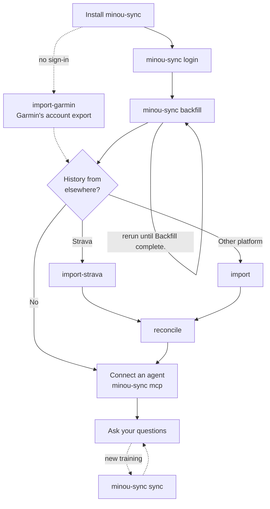
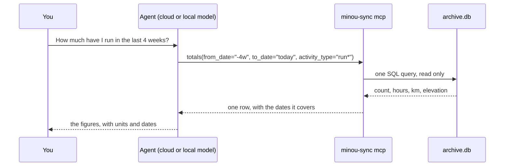

# Getting started

This guide takes you from install to asking an agent about your own training.
[Install](../README.md#quick-start) minou-sync first, then follow the steps here. Near the end is a reference to
every tool the agent can use and every command, followed by what to do when something goes wrong.

## The whole journey

There are two stages:

1. **Build the archive.** The CLI imports your history from Garmin and any other platform, and consolidates the
   sources so a workout recorded on two of them appears once. Then it cleans the result: it flags impossible
   values and works out your best efforts from the original files.
2. **Ask questions.** `minou-sync mcp` gives an agent read-only tools over the archive, and the agent answers
   from your own numbers.



The CLI never answers questions itself. It produces `archive.db` in your data folder, and the agent reads it
through the MCP server. You run the data commands again only when you have new training to pull in.

The first command you run asks where to keep your data. Press Enter for `~/.local/share/minou-sync`, or give
another folder. Paths below such as `logs/sync.log` or `reports/` are inside that folder, and `minou-sync
status` shows where it is.

## Get your Garmin data

1. **Sign in**, once, in a terminal. It asks for your email, password and MFA code, then saves session tokens
   in `~/.garminconnect`. Your password isn't stored.

   ```sh
   minou-sync login
   ```

2. **Fetch your history.** Each run makes up to 500 requests and saves its progress, so run it again until it
   prints "Backfill complete." Waiting a few minutes between runs is kinder to Garmin's servers. Two years of
   history takes about 25 runs.

   ```sh
   minou-sync backfill
   ```

   Wellness days start at your first activity. To reach days before that, add `--from YYYY-MM-DD`.

3. **Stay current.** Run this whenever you want the latest activities and days. It fetches what's new since the
   last run, then merges and works out efforts. `--days N` (1 to 90) fetches a fixed number of recent days
   instead.

   ```sh
   minou-sync sync
   ```

4. **Or let it run every day.** On a Mac, `schedule` adds a launchd job that runs `sync` daily at 09:00
   (`--at HH:MM` for another time). Nothing stays running in between: launchd starts the sync, it takes a minute
   or two, and it exits. If the Mac is asleep at that time, it runs when it wakes. If it's off, the next run picks
   up the missed days. If the network isn't back yet, it tries again every 2 minutes for 10 minutes, then leaves
   it to the next day. Output goes to `logs/sync.log` in the data folder, and `status` shows whether the daily
   sync is on.

   ```sh
   minou-sync schedule                    # every day at 09:00
   minou-sync schedule --notify errors    # only tell me when something goes wrong
   minou-sync schedule --off              # stop it
   ```

   By default you get a notification when a run brings in something new, such as "2 new activities: Morning
   ride, Easy run. Sleep and recovery through Wed 21 Oct." Days with nothing new stay quiet. A run that fails
   always tells you, and if Garmin wants you to sign in again it says to run `minou-sync login`. `--notify`
   takes `new` (the default), `errors`, `always` or `off`. On a Mac the notifications come from Script Editor;
   macOS asks once whether to allow them, and System Settings → Notifications → Script Editor turns them off.

   The job needs a data folder macOS lets it read without asking. The default, `~/.local/share/minou-sync`, is
   fine. Desktop, Documents, Downloads, iCloud Drive and external drives ask for permission first, which a
   scheduled job can't answer, so `setup` and `schedule` warn about them. Run `schedule` again after
   reinstalling minou-sync somewhere else; `setup` re-points the job when the data folder moves. On Linux,
   `schedule` prints a crontab line to add instead.

## Or start from Garmin's account export

Garmin will email you a copy of everything it holds. Importing it needs no sign-in and no backfill runs, and it
keeps working if Garmin changes its sign-in. It's a snapshot, so run `sync` afterwards for new days.

1. Sign in at garmin.com/account, go to Data Management → Export Your Data and request the export. The email
   with the download link can take several days.
2. Download the zip and import it from wherever it landed:

   ```sh
   minou-sync import-garmin ~/Downloads/<id>_1.zip
   minou-sync reconcile
   ```

It reads the activity summaries, the original FIT recordings, daily wellness (resting HR, HRV, sleep, Body
Battery, stress, steps, training readiness) and weigh-ins. Each recording is matched to its activity by start
time. An unpacked folder works too, and if Garmin splits the export into several zips, import each one.

You can use the export and `sync` together. Activities sync has stored are left as they are, a day only gets
its empty fields filled in, and re-running the import changes nothing. The export fills some gaps the API
leaves, such as overnight HRV on older days. It doesn't hold Garmin's HRV status (balanced, unbalanced). The
watch's all-day monitoring files and ECG recordings are in the export too, but minou-sync doesn't read them yet.

## Add your Strava history

Strava's account archive holds every activity you uploaded, with the original files. It's worth adding if you
used Strava before Garmin, or recorded on other devices.

1. On strava.com (the app can't do this), go to Settings → My Account, click Get Started under Download your
   account, then Request download.
2. When the email arrives, download the zip.
3. Import it and merge:

   ```sh
   minou-sync import-strava ~/Downloads/export_<id>.zip
   minou-sync reconcile
   ```

A workout recorded on both Garmin and Strava becomes one activity. Re-running the import changes nothing.

## Import from other platforms

Garmin stays the live source, but you can bring in history from anywhere that lets you export. One command
reads a CSV, a folder or a zip:

```sh
minou-sync import <path> --source <name>
minou-sync reconcile
```

- `--source` names the platform, such as `nrc` or `intervals`. Each source gets its own folder under
  `files/` in the data folder.
- Activity summary CSVs are read through a profile, which maps the platform's columns to minou-sync's. The
  profile is detected from the CSV header. Pass `--profile <name-or-path>` to choose one yourself.
- Original FIT, GPX and TCX files are read directly.
- Daily wellness, weigh-in, body-composition and lab-test CSVs use minou-sync's own templates.

[import.md](import.md) has the templates, the built-in profiles and how to export from common platforms.
Re-running an import changes nothing.

When the same workout comes from several sources, `reconcile` uses Garmin first, then Strava, then the other
sources in alphabetical order. `--source-order intervals,nrc` sets that order yourself.

## Check and export the archive

```sh
minou-sync status       # data folder, counts, date range, last sync and archive size
minou-sync export-csv   # writes activities.csv and daily_wellness.csv to exports/ in the data folder
```

Each `reconcile` also writes a report to `reports/reconcile-<date>.csv` in the data folder. It counts
activities by year and source, and lists distance differences over 5%, multisport legs and any activity flagged
as implausible.

## Best efforts and records

minou-sync works out your best efforts from your original files, so records cover your whole history,
whichever device recorded it. For runs it finds your fastest 1 km, mile, 5K, 10K, half marathon, marathon and
50K. For rides it finds your best 5-, 20- and 60-minute power and fastest 40 km. GPS glitches are dropped first,
so a stray jump can't invent a fast split. An activity flagged with impossible values never sets a record.

Efforts are computed automatically after `import`, `import-garmin`, `import-strava` and `sync`. To compute them
yourself:

```sh
minou-sync efforts        # new files only
minou-sync efforts --all  # recompute the whole archive
```

A long history takes a few minutes. If you stop it, the next run carries on where it left off.

## Choose or change the data folder

The first command asks where to keep your data and saves the answer in `~/.config/minou-sync/config.toml`.
Commands with nobody at the keyboard, such as the daily sync and MCP clients, don't ask; they use the saved
folder, or `~/.local/share/minou-sync` if none is saved yet.

To change it later, run `setup`. It offers to move your existing archive to the new folder and points the
daily sync there:

```sh
minou-sync setup                       # asks for the folder
minou-sync setup ~/training-archive --move
```

For a single run or a single shell, `--data-dir` (before the command) or `MINOU_SYNC_DATA_DIR` override the
saved folder:

```sh
minou-sync --data-dir ~/training-archive status
MINOU_SYNC_DATA_DIR=~/training-archive minou-sync sync
```

Keep the folder out of git repositories and synced folders such as iCloud Drive or Dropbox. It holds your
health data, and SQLite files can be damaged when a sync service copies them mid-write.

## Connect an agent

Everything is in `archive.db` in your data folder, a plain SQLite file. An agent can read the file directly.
The MCP server gives it read-only tools instead, so the agent asks for a total or a list and doesn't have to
write SQL.



The server does the counting, summing and date arithmetic, and returns short answers. They're small enough
for a model running on a laptop, and a large cloud model uses the same tools. The server makes no network
requests of its own. What a client sends to its model provider is up to that client.

Each client registers the server in its own way. Desktop apps don't read your shell's PATH, so give `command`
the absolute path that `which minou-sync` prints, such as `/Users/<you>/.local/bin/minou-sync` after a pipx
install. The server uses your saved data folder.

### Claude Code

```sh
claude mcp add minou-sync -- minou-sync mcp
```

Check that `minou-sync` shows as connected (`claude mcp list`) before you start. Add `-s user` to have it in
every project.

### Kiro

Kiro reads its own config. Create `.kiro/settings/mcp.json` in your workspace, or `~/.kiro/settings/mcp.json`
for every workspace:

```json
{
  "mcpServers": {
    "minou-sync": {
      "command": "/Users/<you>/.local/bin/minou-sync",
      "args": ["mcp"],
      "disabled": false,
      "autoApprove": ["archive_summary", "list_activities", "get_activity", "totals", "breakdown",
                      "wellness", "wellness_after", "load_balance", "best_efforts"]
    }
  }
}
```

Then reconnect from the MCP Server view. The read tools are on `autoApprove`. `add_note` and `query_sql` stay
off it, so a write still asks first.

### Claude Desktop and Cursor

Add the same entry under `mcpServers`: in Claude Desktop's config, or in `.cursor/mcp.json` (project) or
Cursor's global MCP settings. Use the absolute path.

### Open WebUI

Run `minou-sync mcp --http` and point Open WebUI at `http://127.0.0.1:8766/mcp`, with either a cloud model's key
or a local model through Ollama. minou-sync doesn't bundle Open WebUI. Over HTTP the server binds `127.0.0.1`
only and refuses requests whose Host or Origin isn't local. `--port` changes the port.

### A local model in the terminal

A local model keeps your data on your computer. Ollama doesn't speak MCP itself, so a bridging client such as
[ollmcp](https://github.com/jonigl/mcp-client-for-ollama) sits in between.

1. Install [Ollama](https://ollama.com) and pull a model whose Ollama card lists the `tools` capability.
   `ollama show <model>` lists the capabilities. The recording below uses `gemma4:e2b`, a small model that runs
   on a laptop.
2. Install ollmcp with `uv tool install ollmcp`.
3. Write a server config and start ollmcp:

   ```sh
   cat > ollmcp-servers.json <<'JSON'
   { "mcpServers": { "minou-sync": {
       "command": "/Users/<you>/.local/bin/minou-sync", "args": ["mcp"] } } }
   JSON
   ollmcp --servers-json ollmcp-servers.json --model <your-model>
   ```

4. Give the model room to read. The tool list alone is about 3,600 tokens, and most answers add 300 to 1,500
   more. Ollama's default context window can be as small as 4,096 tokens depending on your memory
   ([Ollama docs](https://docs.ollama.com/context-length)). In ollmcp, open `/model-config`, set `num_ctx` to at
   least 8192, then run `/save-config`. While a chat is running, `ollama ps` shows the context size in use.
5. Set the system prompt (see [Ask your questions](#ask-your-questions)), then ask.


ollmcp starts the server once and keeps it running. After you update minou-sync, run `/reload-servers` (or
restart ollmcp), or the model keeps seeing the old tools. A small model can also get confused by earlier
answers in the same chat. `/clear` starts a fresh conversation.

Whichever client you use, check that `minou-sync` shows as connected, with its tools listed, before you ask
anything. If the tools aren't there, the agent can't reach your data and will say so.

## Ask your questions

With a client connected, ask your question. The agent picks the tools, and the server does the arithmetic.

Give the model one short, general system prompt at the start, so it uses the tools and reports units and dates.
You don't need a rule per question, because each tool's description tells the model when to use it and how to
scope it. The repo ships one at [`prompts/system-prompt.txt`](../prompts/system-prompt.txt). How you set it
depends on the client:

- **A system-prompt field** (most desktop clients): paste the file's contents into it.
- **ollmcp:** open `/model-config`, enter `sp`, paste the prompt on one line (the field is single-line, so a
  multi-line paste breaks), then `s` to save. Run `/save-config` once and it loads automatically next time.
- **Claude Code, Kiro and other agent IDEs** already have their own system prompt. Ask your questions, or
  paste the file's contents as your first message.

With a small local model, it helps to ask it to name the tool and arguments it called. You can then see how an
answer was built and spot a wrong turn.

Things the tools can answer:

- "How much have I run year to date, distance and elevation?"
- "How many activities of each type this year?"
- "Distance, time on feet and elevation each week for the last 12 weeks, by activity type."
- "How many hours did I ride last month?"
- "My five longest runs this year, by distance and by time on feet."
- "I have a 110 km, 6,400 m race in nine months. How do the last 12 weeks compare: longest activity, biggest
  climbing day, weekly elevation?"
- "My monthly load split between low aerobic, high aerobic and anaerobic, against Garmin's targets."
- "Sessions by training effect in the last 8 weeks against the 8 before."
- "Acute load, chronic load and their ratio over the last 6 weeks. Am I building too fast?"
- "HRV and sleep over the last two weeks."
- "HRV, sleep and Body Battery in the two days after my five hardest sessions this year."
- "My running records for 1 km, mile, 5K, 10K, half and marathon, with dates."

A record or a fastest split from an activity with impossible values is left out, so the numbers you get back
are the clean ones. The agent can also tell you when Garmin's own record was set by one of those activities.

A small local model answers most single questions well. Questions that need several steps, such as the race
comparison above, are less reliable on it. If those matter to you, try a larger model with the same questions
and compare.

## The tools

These are the tools `minou-sync mcp` offers. The agent chooses among them, so you don't call them yourself.
Knowing them helps you phrase a question.

| Tool | What it answers |
|---|---|
| `archive_summary` | What's in the archive: activities by source and type, the date range, wellness days, the last sync |
| `list_activities` | Particular activities, sorted by date, distance, duration, elevation or training load ("my five longest runs") |
| `get_activity` | One activity in full, with the sources it came from and any notes |
| `totals` | Count, hours, distance and elevation for a span, or per day, week or month ("how much did I run this year") |
| `breakdown` | The same figures grouped by activity type or Garmin's training-effect label ("sessions by type") |
| `wellness` | Daily resting HR, HRV, sleep, Body Battery, stress, steps, readiness and training load for a date range |
| `wellness_after` | Wellness on the days after a list of dates ("recovery after my hardest sessions") |
| `load_balance` | Garmin's monthly load split (low aerobic, high aerobic, anaerobic) against its targets |
| `best_efforts` | Running and riding records, with the activity and date that set each one |
| `add_note` | Saves a note against an activity or a day. The only tool that writes, and it never changes your data |
| `query_sql` | One read-only SQL query, for anything the other tools don't cover. Only with `minou-sync mcp --sql` |

A few things the tools understand, which help with phrasing:

- **Activity families.** `run*` covers road, trail and treadmill runs, and `ride*` every kind of ride. "How much
  have I run" counts them all.
- **Relative dates.** "The last 4 weeks" becomes `-4w`, and the server works out the dates.
- **Comparisons.** "The last 8 weeks against the 8 before" is one call, with the change worked out by the
  server.

## Command reference

| Command | What it does | Options |
|---|---|---|
| `setup` | Chooses the data folder and moves the archive there | `<folder>`, `--move` |
| `login` | Signs in to Garmin once and saves session tokens | |
| `backfill` | Fetches your whole Garmin history, up to 500 requests a run; rerun to continue | `--from YYYY-MM-DD` |
| `sync` | Fetches new Garmin activities, files and wellness, then reconciles | `--days N` (1 to 90), `--notify new\|errors\|always` |
| `schedule` | Runs `sync` every day on a Mac (launchd) and notifies you when new data arrives; prints a crontab line elsewhere | `--at HH:MM`, `--notify new\|errors\|always\|off`, `--off` |
| `import-garmin` | Loads a Garmin account export (zip or unpacked folder); fills what sync hasn't stored | |
| `import-strava` | Loads a Strava account archive (zip or unpacked folder) | |
| `import` | Loads a CSV, folder or zip from any platform | `--source <name>`, `--profile <name-or-path>` |
| `reconcile` | Merges every source's records into one activity list and flags implausible values | `--source-order a,b` |
| `efforts` | Works out best efforts from the original files | `--all` |
| `status` | Counts, date range, last sync, the daily sync time and archive size | |
| `export-csv` | Writes `activities.csv` and `daily_wellness.csv` to `exports/` in the data folder | |
| `mcp` | Serves the archive to MCP clients over stdio | `--http`, `--port N`, `--sql` |

Every command takes `--data-dir <path>` (before the command name) and `-v` for more detail.
`minou-sync <command> --help` lists the options, and `minou-sync --version` prints the version.

`sync` and `backfill` exit with 0 when done, 1 when they stopped at the request cap or Garmin's rate limit
(progress is saved; run again), 2 when Garmin needs you to sign in again, and 3 when Garmin couldn't be
reached.

## When something goes wrong

- **Garmin sign-in fails or sync stops working.** `garminconnect` is unofficial, so a change at Garmin can break
  it until the library is updated. Run `minou-sync login` again first.
- **An import times out.** Don't run two writers at once. A `sync` or `backfill` holds the database for about 17
  seconds per day it fetches, so start the import when it has finished.
- **The agent says it has no data.** Check that `minou-sync` shows as connected in your client, with its tools
  listed. With ollmcp, `/reload-servers` reconnects it.
- **A local model gives an odd answer.** Start a fresh chat (`/clear` in ollmcp), check `num_ctx` is at least
  8192, and ask it which tool and arguments it used.
