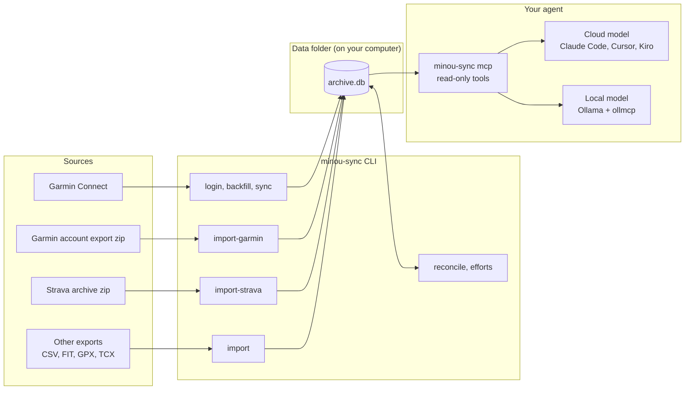
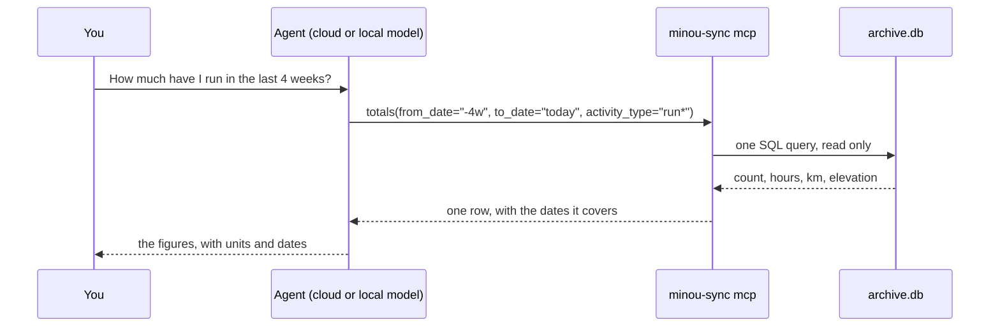

# How it works

minou-sync is a command-line tool that builds one SQLite file from your training data, plus an MCP server that lets an AI agent read it. The CLI collects and cleans the data. The agent answers your questions. Neither needs the other running.

## Building the archive

The CLI builds the archive in two passes. First it imports from each source and merges them so a workout recorded on two platforms appears once. Then it cleans the result: it flags impossible values and works out your best efforts. Only `login`, `backfill` and `sync` use the network and only to talk to Garmin.

- **Garmin:** minou-sync signs in once with your email, password and MFA code and then uses the saved session tokens. Your password isn't stored. Calls go through the unofficial [`garminconnect`](https://github.com/cyberjunky/python-garminconnect) library. They're read-only and paced at most one request a second and 500 per run.
- **Garmin's own export:** Garmin emails you a copy of your account on request. `import-garmin` loads its activities, original files, daily wellness and weigh-ins with no sign-in. Anything sync has already stored is left as it is and only empty fields are filled in.
- **Strava:** you request your account archive from Strava and import the zip. No Strava API key is needed.
- **Other platforms:** any CSV, folder or zip of FIT, GPX or TCX files comes in through a profile ([import.md](import.md)).

## Merging

A Garmin and a Strava activity are the same workout when they start within 5 seconds of each other. They also match when they start within 2 minutes and their elapsed times are within 5% (or 60 seconds for short sessions). Garmin's values come first. Strava fills the gaps and supplies titles. A multisport session is one activity and its legs are listed in the reconcile report.

Records from other platforms merge the same way. Garmin wins, then Strava, then the other sources in alphabetical order. `reconcile --source-order` changes that order.

## What the archive holds

- **Every activity.** All your Garmin activities and your full Strava history in one table, with the original FIT, GPX or TCX file for each.
- **Every day of Garmin wellness.** Sleep, HRV, resting heart rate, stress, Body Battery, steps, training readiness, training status, VO2 max and weigh-ins from your first Garmin activity. `backfill --from YYYY-MM-DD` reaches days before that.
- **Best efforts and records** from your original files. For runs that's the fastest 1 km, mile, 5K, 10K, half marathon, marathon and 50K. For rides it's the best 5-, 20- and 60-minute power and the fastest 40 km. GPS jumps are dropped first. An activity with impossible values is flagged and never sets a record.
- **The complete Garmin responses.** Every response from Garmin is stored as it came so you can query fields the summary tables leave out.
- **Your own records.** Weigh-ins, body composition scans and lactate-threshold tests from a CSV.
- **Plain files too.** `export-csv` writes CSV copies of the activities and daily wellness tables.

`minou-sync sync` adds new activities and recent days. `minou-sync schedule` runs it once a day on a Mac and tells you what came in. A second notification restates Garmin's latest training readiness (score, level, recovery left, any poor factor) with fixed rules and no model.

## Answering questions

`minou-sync mcp` gives an agent read-only tools over the archive. The agent asks for a total, a list or a record and doesn't have to write SQL.

The server does the counting, summing and date arithmetic and returns short answers. They fit in the 8k context of a model running on a laptop or phone. A large cloud model uses the same tools. The tools have been tested with Claude in Claude Code and with Gemma 4 (`gemma4:e2b`) through Ollama.

The server makes no network requests of its own. What a client sends to its model provider is up to that client. With a local model the data stays on your computer.
